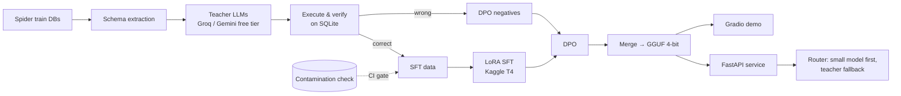

# Distill-SQL

**A 1.5B text-to-SQL model distilled from large LLMs. It runs on a laptop.**

> 🚧 Work in progress. Numbers below are placeholders until the evaluation phases are complete.
> The full design record is in [docs/PLAN.md](docs/PLAN.md).

## The problem

Large LLMs write good SQL, but every query costs money, sends your schema to a third party, and takes
seconds. Most analytics questions are routine. A small local model could answer them, and the
expensive model would only be needed for the hard cases.

Distill-SQL fine-tunes **Qwen2.5-Coder-1.5B-Instruct** on SQL that larger teacher models generated
and that we **checked by running it against real databases**. Then it measures how much of the teacher's
accuracy survives, and what that costs.

## Results (baselines so far)

All models get the same zero-shot prompt (schema as `CREATE TABLE` + 3 sample rows, then the
question). Teachers are scored on fixed, stratified subsets (200 Spider-dev / 100 BIRD questions)
because free tiers can't afford the full sets. Full tables with confidence intervals,
significance tests and per-difficulty results: [results/README.md](results/README.md).

| Model | Spider dev EX (subset 200) | BIRD Mini-Dev EX (subset 100) | p50 latency | Peak memory | Cost / 1k queries* |
|---|---:|---:|---:|---:|---:|
| Qwen2.5-Coder-1.5B base, Q8 GGUF (local, M1 Pro) | 62.5% | 20.0% | 0.36 s | 2.8 GB | $0 |
| + SFT (ours) | Phase 4 | | | | $0 |
| + SFT + DPO (ours) | Phase 5 | | | | $0 |
| + SFT + DPO, 4-bit GGUF (ours) | Phase 6 | | | | $0 |
| Teacher: `gemini-3.1-flash-lite` | 80.0% | 68.0% | 2.1 s | – | $0.25 |
| Teacher: `gpt-oss-120b` (Groq) | pending | pending | | – | |
| Teacher: `qwen3.8-27b` (Groq) | pending | pending | | – | |

On the full sets the base model scores **63.4%** on Spider dev (1,034 q, 95% CI 60.5–66.3)
and **21.4%** on BIRD Mini-Dev (500 q). Its main failure mode is schema linking (columns from
the wrong table, columns that don't exist) and, on BIRD, MySQL-only functions such as `YEAR()`.

EX = execution accuracy: the predicted SQL returns the same rows as the gold SQL.
\*Paid list price per 1,000 queries; we pay $0 on free tiers. Local models have no marginal cost.

## Architecture



## Repository layout

```
configs/           YAML configs (validated by pydantic): data, generation, training, eval, serving
src/distill_sql/   the Python package
  config.py        typed config loading
  data/            download, schema extraction, contamination check
  generation/      teacher clients, rate limiting, caching
  verification/    execute + filter + dedupe generated SQL
  training/        dataset builders for SFT / DPO (GPU code lives in notebooks/)
  evaluation/      metrics, eval harness, reports
  serving/         FastAPI app
  router/          small-model-first router for sql-analyst-agent
notebooks/         Kaggle-ready training notebooks
demo/              Gradio app for Hugging Face Spaces
tests/             pytest suite (+ fixtures for the CI eval regression check)
docs/              plan, design notes
data/, runs/       local only, git-ignored
```

## Quickstart

```bash
# 1. install (uses uv: https://docs.astral.sh/uv/)
make install

# 2. secrets
cp .env.example .env   # then add your free Groq / Gemini keys

# 3. checks
make test

# 4. data (Phase 1): downloads ~1 GB, builds data/processed/ in about 5 s after download
make data
make check-contamination

# 5. synthetic data (Phase 2): resumable, re-run once a day until enough data
make generate-dry                 # example prompt + rate-limit budget, no API calls
make generate MAX_CALLS=5         # small pilot
make generate                     # all teachers in parallel, stops cleanly at daily limits
make verify                       # execute + filter + dedupe -> data/processed/train/sft.jsonl
make crosscheck CHECKER=gemini-flash-lite   # optional: second teacher re-answers kept questions
make verify && make check-contamination

# 6. evaluation (Phase 3): needs llama.cpp for local models (`brew install llama.cpp`)
make models                                    # base model GGUF (1.9 GB, sha256-checked)
make eval MODEL=base-q8 SET=spider_dev         # predict -> execute -> score (resumable)
make eval MODEL=gpt-oss-120b SET=spider_dev_200
make eval-report                               # rebuilds results/README.md
make ci-eval                                   # CI regression check on frozen predictions
```

Outputs: `data/processed/registry.json` (every DB with its train/eval/excluded role),
`examples/` (all questions in one format), `schemas/` (per-DB schema + sample rows) and
`reports/data_report.md`. Phase 2 adds `train/sft.jsonl`, `rejected/rejected.jsonl` and
`reports/generation_report.md` (keep rates, rejection reasons, SQL complexity, cost at list price).
Run `make help` for every command.

## Data and licences

| Asset | Licence | Use here |
|---|---|---|
| [Spider 1.0](https://yale-lily.github.io/spider) | CC BY-SA 4.0 | Train-split DBs for generation; dev/test for evaluation only |
| [BIRD Mini-Dev](https://github.com/bird-bench/mini_dev) | CC BY-SA 4.0 | Evaluation only |
| [test-suite-sql-eval](https://github.com/taoyds/test-suite-sql-eval) | Apache-2.0 | Spider hardness and exact-match scoring |
| [Qwen2.5-Coder-1.5B-Instruct](https://huggingface.co/Qwen/Qwen2.5-Coder-1.5B-Instruct) | Apache-2.0 | Base model |

Synthetic datasets derived from these databases are released under **CC BY-SA 4.0** (ShareAlike).
No dataset files are committed to this repository.

**No test-set contamination:** training data is generated only from Spider *train* databases.
`make check-contamination` fails if any eval database, schema or question appears in the training
data (it compares names, schema fingerprints, exact and near-duplicate questions, and 13-grams). CI
runs the checker's unit tests. On the real data it caught one cross-dataset leak: Spider's
*train* `formula_1` is the same database as BIRD Mini-Dev's `formula_1`. That database is excluded from training.

| Split | Role | Questions | DBs |
|---|---|---:|---:|
| Spider train (`train_spider` + `train_others`) | databases for synthetic generation | (8,659 not used as labels) | 138 usable (8 excluded) |
| Spider dev | eval: model selection | 1,034 | 20 |
| Spider test | eval: final, run once | 2,147 | 40 |
| BIRD Mini-Dev (SQLite) | eval: harder, out-of-domain | 500 | 11 |

## Design decisions

See [docs/PLAN.md](docs/PLAN.md) for the full list. Short version:
- **Execution-verified distillation.** Teacher SQL is kept only if it runs and returns a plausible result.
- **Synthetic-only training data.** No Spider train labels, so the gains come from the teachers.
- **Cost is a first-class metric.** Every result row has a cost per 1,000 queries.

## Limitations

To be completed in Phase 10. Known now: public benchmarks may already be in the pretraining data of
both the base model and the teachers, and we can only measure SQLite.

## Cost breakdown

| Item | Cost |
|---|---|
| Teacher API calls (Groq / Gemini free tiers) | $0 |
| Training (Kaggle free GPU) | $0 |
| Tracking (MLflow local) | $0 |
| Hosting (Hugging Face Hub + Spaces free tier) | $0 |
| **Total** | **$0** |

## Reproduce

To be written as phases land. Every run saves its resolved config, seed, git SHA and metrics to `runs/<run_id>/`.
