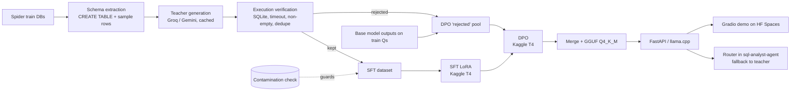

# Distill-SQL — Phase 0 Plan

> Written 2026-10-26. This is the design record for the project. Every later phase refers back to it.
> If a decision changes, update this file and add a line to the **Decision log** at the bottom.

## 1. Goal in one sentence

Fine-tune a ~1.5B open model on SQL written by large "teacher" LLMs, so it gets as close as possible to
the teacher's **execution accuracy** while running on a laptop for almost no money.

Headline we want to earn (with real numbers):
> "My 1.5B model reaches **X%** of a frontier model's execution accuracy on Spider at **1/Y** of the cost,
> and runs at **Z tokens/sec** on a MacBook."

---

## 2. Base model choice

I checked the Hugging Face Hub on 2026-10-26 for the small models from Qwen:

| Candidate | Params | Released | Arch | Licence | Notes |
|---|---|---|---|---|---|
| **Qwen/Qwen2.5-Coder-1.5B-Instruct** | 1.54B | 2024-09 | Standard dense transformer | Apache-2.0 | Trained for code, including SQL. Very good support in TRL, PEFT and llama.cpp. Many published text-to-SQL baselines use it. |
| Qwen/Qwen3-1.7B | 1.7B | 2025-04 | Dense | Apache-2.0 | General model with a thinking mode. Not code-specialised. |
| Qwen/Qwen3.5-2B | 2.27B | 2026-02 | Hybrid: Gated-DeltaNet linear attention plus full attention, wrapped as a vision-language model | Apache-2.0 | Newest small Qwen. But it is a multimodal wrapper, and its linear-attention kernels are slow or unsupported on Kaggle's T4/P100 GPUs. LoRA and GGUF support are less mature. |

Qwen has released **no code-specialised model smaller than 30B** since Qwen2.5-Coder. Qwen3-Coder and
Qwen3-Coder-Next are 30B and larger.

**Decision: `Qwen/Qwen2.5-Coder-1.5B-Instruct`.**

Reasons:
1. It is the only small model Qwen trained specifically on code.
2. Its plain transformer architecture trains in fp16 on a free T4 GPU and converts to GGUF with no surprises.
3. Many papers report numbers for it, so our results can be compared with theirs.

The base model is a single config value (`model.base_id`). We will run **Qwen3.5-2B as an ablation**
(same data, same recipe) if Kaggle time allows. Interview line: *"I chose the most reliable model for
my compute budget, and I measured the newer one instead of assuming it was better."*

---

## 3. Data

### 3.1 Sources and licences

| Dataset | Used for | Size | Licence |
|---|---|---|---|
| **Spider 1.0** (Yu et al., 2018) | Training databases (train split only); main eval (dev); final held-out eval (test) | 200 DBs, about 10k questions | CC BY-SA 4.0 |
| **BIRD Mini-Dev** (Li et al., 2023/24) | Harder, real-world secondary eval (SQLite version) | 500 questions, 11 DBs | CC BY-SA 4.0 |
| **test-suite-sql-eval** (Zhong et al., 2020) | Official Spider difficulty labels and exact-match code (vendored) | — | Apache-2.0 |

The ShareAlike licence means any dataset we publish that is derived from Spider or BIRD databases
(our synthetic SFT/DPO data) must also be released under **CC BY-SA 4.0**. Model weights are released
under Apache-2.0, matching the base model. We will repeat this in the README and the dataset card.

### 3.2 Splits and their roles

```
Spider train DBs (138 usable) ──► teachers generate question→SQL ──► SFT / DPO training data
Spider dev (1,034 q, 20 DBs) ──► model selection + all intermediate numbers
BIRD Mini-Dev SQLite (500 q, 11 DBs) ──► secondary eval (out-of-domain, harder)
Spider test (2,147 q, 40 DBs) ──► run ONCE at the end for the final table
```

We **do not use the Spider train questions** as training targets. Training data is 100% synthetic
from the teachers. That keeps the project a real distillation project. We may use a few train
questions as few-shot examples in the teacher prompt; those come from the train split, so this is allowed.

### 3.3 Contamination guard (automated, runs in CI)

`make check-contamination` fails the build if any of these is true:
1. A training example's `db_id` is in the set of dev or test `db_id`s.
2. A training example's database has the **same schema fingerprint** (a hash of normalised table and
   column names) as any eval database. This catches the same database saved under another name.
3. A training question matches an eval question after normalisation (lowercase, strip punctuation,
   collapse whitespace).
4. A training question shares any **13-gram** with an eval question. This is the GPT-3 / Llama
   contamination test.
5. A training question is a **near-duplicate** of an eval question: Jaccard similarity of word
   3-grams ≥ 0.8. Spider questions are short (about 10 words), so most of them have no 13-gram at
   all; this rule is what catches paraphrases.
6. A training row uses a database that is **excluded** from training, or one that isn't in the registry.

The check runs on the real data with `make check-contamination`, and must pass before any training
run. CI runs its unit tests on synthetic SQLite fixtures, because the datasets are never committed.

#### What the check found on the real data (2026-10-27)

| Finding | Action |
|---|---|
| Spider *train* `formula_1` is the **same database** (same name and schema fingerprint) as BIRD Mini-Dev `formula_1` | Excluded from training in `configs/base.yaml`. Without the cross-dataset check this would have inflated our BIRD score. |
| 7 Spider train DBs are **empty** (`academic`, `geo`, `imdb`, `restaurants`, `scholar`, `yelp`, `music_2`) | Excluded automatically: with 0 rows, generated SQL can't be execution-verified. |
| BIRD `financial` has a table called `order` (an SQL keyword) | Schema rendering now quotes SQLite keywords, so prompts show `"order"`. |
| Dry run with Spider's 7,000 train questions: 39 **exact** matches with eval questions, all generic ("How many books are there?") but on *different* databases | Kept strict. Phase 2 drops any flagged row before writing training or few-shot data. |
| Near-duplicate similarity between 0.6 and 0.79 is all template collisions ("names of all the playlists" vs "...authors") | Threshold kept at 0.8. Nothing real sits above it except exact matches. |

Final split: **138 train DBs, 71 eval DBs, 8 excluded**, and no overlap by name or schema.

We cannot control what the teachers and the base model saw during pretraining (Spider has been
public since 2018). We will state this limitation openly. This is the reason we also report
BIRD Mini-Dev and the later-released Spider test set.

---

## 4. Teachers (free tiers)

| Provider | Model (configurable) | Free-tier limits seen on 2026-10-26 |
|---|---|---|
| Groq | `openai/gpt-oss-120b` | 30 RPM, 1K RPD, 8K TPM, 200K TPD |
| Groq | `qwen/qwen3.8-27b` | 30 RPM, 1K RPD, 8K TPM, 200K TPD |
| Google | `gemini-2.5-flash` (or the current Flash) | Shown per account in AI Studio. Not published. |

**Rate limits are the main bottleneck** (200K tokens/day per Groq model). Design consequences:
- **Batch prompts.** One call asks for 8–10 question/SQL pairs for one database. That gives about
  1,000–1,500 raw pairs per model per day.
- **Disk cache keyed by sha256(provider, model, prompt, params).** A re-run never pays twice.
- **Resumable jobs.** Write JSONL as we go and skip keys already done.
- **Token-bucket limiter.** Respects RPM/TPM, plus exponential backoff with jitter on 429 and 5xx errors.
- Target: about **15–25k raw pairs, then about 8–12k verified pairs** after roughly one week of
  daily runs. Published distillation work shows that a few thousand clean pairs already move a 1.5B model.

"Frontier" comparison: for the headline we compare against the **strongest teacher** we can call for
free. We will not claim a GPT-5-class comparison unless we can actually run it at $0.

---

## 5. Pipeline



### Verification rules (Phase 2)
A generated pair is kept only if all of these hold:
- It parses with `sqlglot` (SQLite dialect).
- It executes within a 5 s timeout on a **read-only** connection.
- The result is non-empty and has fewer than 10k rows (empty results are usually wrong; very large
  results usually mean a missing JOIN condition).
- No near-duplicate SQL already exists for that DB. We normalise the SQL with sqlglot, then compare
  both the SQL and its result hash.
- Optional self-consistency: when two teachers answer the same question and their results match,
  we mark the pair `agreement=true`, our highest-quality tier.

Every rejection is logged with a reason code so the stats report can show "kept 61%; 18% empty;
9% error; 7% duplicate; …".

---

## 6. Training (Phase 4–5, Kaggle)

- **SFT:** TRL `SFTTrainer` + PEFT LoRA (r=16, alpha=32, all linear layers), fp16 on a T4, completion-only
  loss (we train only on the SQL tokens), 2–3 epochs, cosine LR schedule from 2e-4.
- **DPO:** TRL `DPOTrainer` on top of the SFT adapter, β=0.1. Chosen = verified SQL. Rejected = SQL
  that runs but returns a **different result** (a "hard negative"), or SQL that fails to execute.
- Kaggle gives about 30 GPU-hours/week on a T4 or P100 (16 GB). A 1.5B LoRA run on about 10k short
  examples takes roughly 1–2 h.
- Seeds fixed. `configs/*.yaml` and resolved config, metrics and git SHA are saved to `runs/<run_id>/`
  for every run.

---

## 7. Evaluation design (Phase 3)

**Same prompt for every model:** the schema as `CREATE TABLE` statements plus 3 sample rows per table,
then the question, then "Return only SQL." Zero-shot. Greedy decoding.

| Metric | How |
|---|---|
| **Execution accuracy (EX)** — main | Run the predicted and gold SQL. Compare result multisets. Order matters only if the gold query has `ORDER BY`. 30 s timeout. |
| Exact match (EM) | Official Spider component-match from test-suite-sql-eval. |
| Valid-SQL rate | The prediction parses and executes without error. |
| Accuracy by difficulty | Spider: easy / medium / hard / extra (official hardness). BIRD: simple / moderate / challenging. |
| Latency p50 / p95 | Wall-clock per query, end to end. |
| Tokens/sec | Generation throughput. |
| Peak memory | RSS for llama.cpp; `torch.cuda.max_memory_allocated` on GPU. |
| Cost per 1,000 queries | Teachers: tokens × **published paid price** (what a company would pay, even though we used a free tier). Local: about $0 marginal cost. We will state the assumption. |

**Comparison grid:** base → SFT → SFT+DPO → SFT+DPO GGUF Q4 → teacher(s), on Spider dev, BIRD
Mini-Dev, and Spider test (final only).

**Statistical honesty:** we report 95% bootstrap confidence intervals on EX, and a paired McNemar test
for "is model A better than model B" on the same questions.

**CI regression check:** a fixed, seeded 50-question subset of Spider dev with **saved predictions**
checked into `tests/fixtures/`. CI re-scores them, which needs no model or GPU, and fails if EX drops
below a threshold in `configs/ci.yaml`. This protects the *scorer* and the *data pipeline* from silent bugs.

---

## 8. Tech choices

| Area | Choice | Why |
|---|---|---|
| Packaging | `uv` + `pyproject.toml` + `uv.lock` | Fast, reproducible, exact pins in the lock file. |
| Config | YAML + pydantic v2 (+ pydantic-settings for secrets) | Typed and validated. A bad config fails at startup, not 2 hours into training. |
| SQL parsing | `sqlglot` | Normalisation, dialect parsing, dedupe. |
| LLM clients | `httpx` + `tenacity` (our own thin client) | One retry and cache layer for both providers. No heavy SDK lock-in. |
| Training | `transformers`, `trl`, `peft`, `datasets` | Industry standard. Runs on Kaggle. |
| Tracking | **MLflow (local file store)** | No account, works offline. Kaggle runs save to `runs/`, and we import them locally. |
| Local inference | `llama.cpp` via `llama-cpp-python` (Metal) | Runs GGUF on Apple Silicon. |
| Serving | FastAPI + uvicorn + slowapi | Validation, rate limiting, OpenAPI docs for free. |
| Demo | Gradio | First-class support on HF Spaces. |
| Quality | ruff (lint+format), mypy (strict on `src/`), pytest | Standard Python stack. |

---

## 9. Risks and how we handle them

| Risk | Impact | Mitigation |
|---|---|---|
| Free-tier limits change or shrink | Slow data generation | Config-driven limits, caching, multiple teachers, resumable jobs. |
| Teacher SQL is wrong but runs (semantic errors) | Noisy training labels | Non-empty filter, two-teacher agreement tier, manual audit of 100 samples. |
| Kaggle session dies after 9–12 h | Lost training | Save a checkpoint every N steps to `/kaggle/working`. Runs are short anyway. |
| T4 has no bf16 | Instability | fp16 + LoRA is fine for 1.5B. Fall back to fp32 LoRA if loss is NaN. |
| Pretraining contamination of public benchmarks | Inflated absolute numbers | Report BIRD Mini-Dev and Spider test as well. Stated in the Limitations section. |
| Spider/BIRD databases are hosted on Google Drive | Download breaks | Download script with checksums and alternative mirrors (HF / OSS links). Data is never committed. |
| GGUF Q4 hurts accuracy | Weaker headline | Benchmark Q4_K_M, Q5_K_M and Q8_0 and report the trade-off. |
| Comparing to "frontier" with only free models | Over-claim | Name the exact teacher model in every claim. |

**Nothing in the plan needs money.** One honest caveat: the "cost per 1,000 queries" for teachers is
calculated from paid list prices. We never actually pay it.

---

## Decision log
- 2026-10-26 — Base model `Qwen2.5-Coder-1.5B-Instruct`. Qwen3.5-2B kept as an optional ablation.
- 2026-10-26 — Training data is synthetic only. Spider train questions are used only as few-shot exemplars.
- 2026-10-26 — MLflow local file store for tracking.
- 2026-10-27 — Exclude Spider `formula_1` from training: BIRD Mini-Dev reuses it (found by the contamination check).
- 2026-10-27 — Exclude empty train DBs automatically (they can't execution-verify SQL).
- 2026-10-27 — BIRD Mini-Dev comes from the Google Drive copy (`minidev_0703.zip`, sha256 pinned). The OSS mirror stalls outside China.
- 2026-10-27 — Near-duplicate threshold 0.8, calibrated on Spider train vs eval questions.
